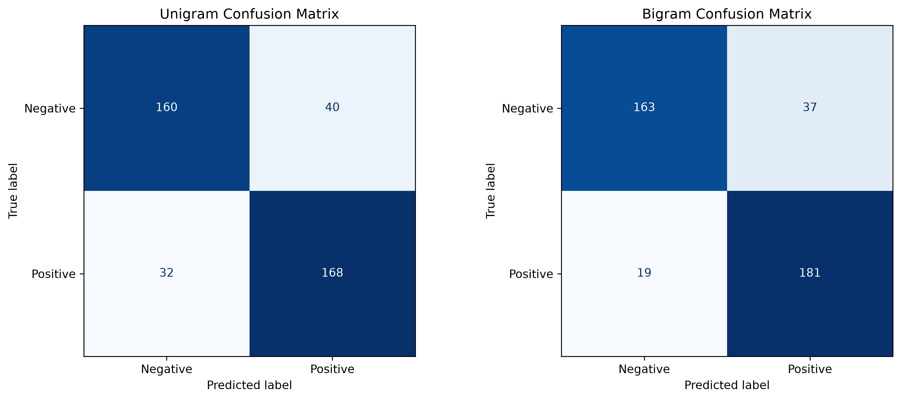
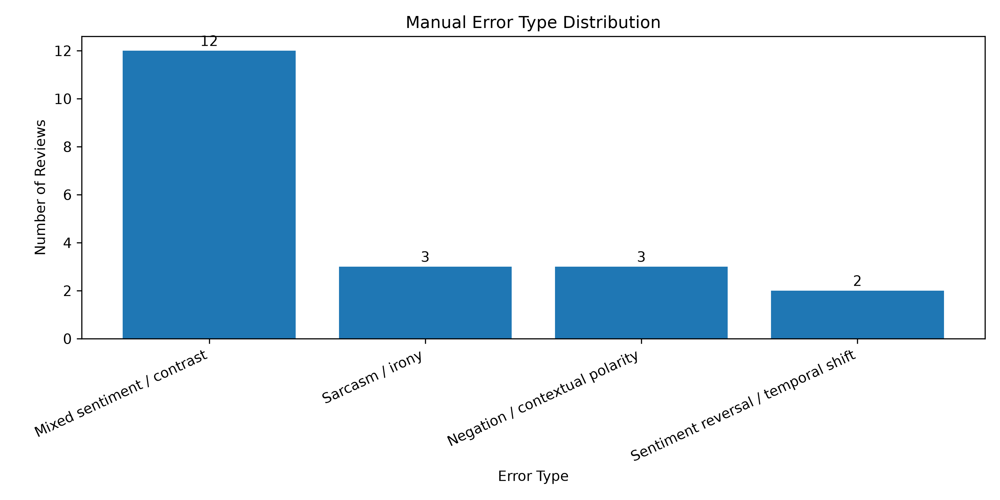

# Movie Review Sentiment Classifier: Comparing Bag-of-Words and Bigram Features with Naive Bayes

A sentiment analysis project comparing **Unigram (Bag-of-Words)** and **Bigram** feature representations using Multinomial Naive Bayes on the NLTK Movie Reviews dataset.

## Team Members
* **Ibrahem Khaled AL-Ghamdi** — Data Preparation & Preprocessing
* **Abdullah Ibrahim Alzahrani** — Unigram Model Implementation
* **Yazeed Alzahrani** — Bigram Model Implementation
* **Mohammed Abdullah Al-Zahrani** — Model Evaluation & Error Analysis
* **Essa Fayez Al-Zahrani** — Prediction Interface (`app.py`) & Project Documentation

---

## Dataset Overview
The models were trained and evaluated on the **NLTK Movie Reviews Corpus** (2,000 total reviews balanced equally between positive and negative classes), split into **1,600 training reviews** and **400 test reviews** (200 positive, 200 negative).

---

## Repository Structure
```text
├── app.py                                      # Interactive CLI sentiment prediction tool
├── requirements.txt                            # Python dependencies
├── README.md                                   # Project documentation and final results
├── data/
│   ├── cleaned_reviews.csv                     # Sample preprocessed reviews
│   ├── unigram_predictions.csv                 # Unigram test set predictions (400 reviews)
│   ├── bigram_predictions.csv                  # Bigram test set predictions (400 reviews)
│   ├── comparison_results.csv                  # Summary evaluation metrics
│   ├── error_analysis_results.csv              # All 78 misclassified reviews with error cues
│   ├── unigram_only_errors.csv                 # 22 reviews misclassified only by Unigram
│   ├── bigram_only_errors.csv                  # 6 reviews misclassified only by Bigram
│   ├── error_analysis_sample_20_annotated.csv  # Manually annotated sample of 20 errors
│   └── manual_error_summary.csv                # Breakdown of manual error categories
├── models/                                     # Saved Unigram and Bigram Naive Bayes models
├── notebooks/
│   ├── evaluation.ipynb                        # Model comparison and confusion matrices
│   └── error_analysis.ipynb                    # Automated and manual error analysis
└── results/
    ├── confusion_matrices_comparison.png       # Side-by-side confusion matrices
    └── manual_error_types_distribution.png     # Distribution of manual error categories
```

---

## Evaluation Results (400 Test Reviews)

Adding bigram features improved overall accuracy by **4.0%** and reduced total misclassifications from **72** down to **56** (most notably cutting false negatives from 32 to 19):

| Model | Accuracy | Precision | Recall | F1-Score | Confusion Matrix (TN / FP / FN / TP) | Total Errors |
| :--- | :---: | :---: | :---: | :---: | :---: | :---: |
| **Unigram (BoW)** | 82.00% | 82.05% | 82.00% | 0.8199 | 160 / 40 / 32 / 168 | 72 |
| **Bigram** | **86.00%** | **86.29%** | **86.00%** | **0.8597** | **163 / 37 / 19 / 181** | **56** |



---

## Error Analysis Summary

Across the 400 test reviews, **78 reviews** were misclassified by at least one model:
* **50 reviews** were misclassified by both models.
* **22 reviews** were misclassified by Unigram only and correctly resolved by Bigram (primarily short negation phrases such as *"not good"*).
* **6 reviews** were misclassified by Bigram only.

A manual inspection of **20 misclassified reviews** categorized the remaining model limitations as follows:

| Error Category | Count | Percentage |
| :--- | :---: | :---: |
| Mixed sentiment / contrast | 12 | 60.0% |
| Sarcasm / irony | 3 | 15.0% |
| Negation / contextual polarity | 3 | 15.0% |
| Sentiment reversal / temporal shift | 2 | 10.0% |



---

## How to Run Locally

1. **Install dependencies:**
   ```bash
   pip install -r requirements.txt
   ```
2. **Launch the interactive prediction CLI:**
   ```bash
   python app.py
   ```
   Enter any movie review text when prompted to view the predicted sentiment from the trained classifier.
